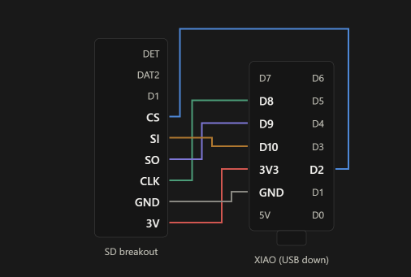

# PocketMind part 3: first recording to a microSD card

The firmware from part 3 of the PocketMind build series on YouTube (keshuirl).
It records **10 seconds** from the built-in microphone of the Seeed XIAO nRF52840 Sense and saves it to a microSD card
as `REC001.WAV`, `REC002.WAV`, … (16 kHz, 16-bit, mono WAV). Built with Zephyr in the nRF Connect SDK.

## Hardware
- Seeed Studio XIAO nRF52840 Sense (header pins soldered)
- Adafruit microSD card breakout (SPI or SDIO), header pins soldered
- Breadboard + male-to-male jumper wires
- microSD card formatted as **exFAT** (we used 128 GB)

## Wiring (XIAO → SD breakout)

| XIAO | SD breakout |
|------|-------------|
| D2   | CS          |
| D8   | CLK         |
| D10  | SI          |
| D9   | SO          |
| 3V3  | 3V          |
| GND  | GND         |

Use **3.3 V, not 5 V**.

## Build and flash (VS Code + nRF Connect extension)
1. Download this folder and put it in your user folder.
2. In VS Code, open the nRF Connect panel → **Open an existing application** → select this folder.
3. **Add build configuration** → board: `xiao_ble/nrf52840/sense` → **Generate and Build**.
4. Double-tap the reset button on the XIAO: it opens as a USB drive (bootloader mode).
5. Copy `build/pocketmind_rec/zephyr/zephyr.uf2` onto that drive. The board restarts and records.

## LEDs
| LED | Meaning |
|-----|---------|
| Blue on | Recording |
| Green on | Saved (press reset to record again) |
| Red blinks 2× | SD card problem (wiring or card) |
| Red blinks 3× | Could not create the file |
| Red blinks 4× | Microphone problem |

To listen: unplug the board first, then take the card out and play the WAV file on your computer.

## Files
- `src/main.c`: the recorder (mic → WAV file on the SD card)
- `app.overlay`: SD card on SPI2 (D8 = CLK, D9 = SO, D10 = SI, D2 = CS) and the PDM mic
- `prj.conf`: Zephyr settings (mic, SPI, SD card, FAT + exFAT)
- `CMakeLists.txt`

## Datasheets
Download (in the `datasheets` folder of this repo):
- [microSD breakout datasheet (Adafruit)](datasheets/adafruit-microsd-spi-sdio.pdf)
- [XIAO board datasheet (Seeed Studio)](datasheets/Seeed-Studio-XIAO-Series-SOM-Datasheet.pdf)

These PDFs are © Adafruit Industries and Seeed Studio, shared here for convenience. The latest versions are on the makers' sites:
- Adafruit microSD breakout, pinouts: https://learn.adafruit.com/adafruit-microsd-spi-sdio/pinouts
- Adafruit microSD breakout, full guide (PDF): https://cdn-learn.adafruit.com/downloads/pdf/adafruit-microsd-spi-sdio.pdf
- XIAO nRF52840 Sense, getting started: https://wiki.seeedstudio.com/XIAO_BLE/
- XIAO nRF52840 Sense, schematic (PDF): https://files.seeedstudio.com/wiki/XIAO-BLE/Seeed_Studio_XIAO_nRF52840_PDF.pdf
- nRF52840 chip, product specification (PDF): https://files.seeedstudio.com/wiki/XIAO-BLE/nRF52840_PS_v1.5.pdf
