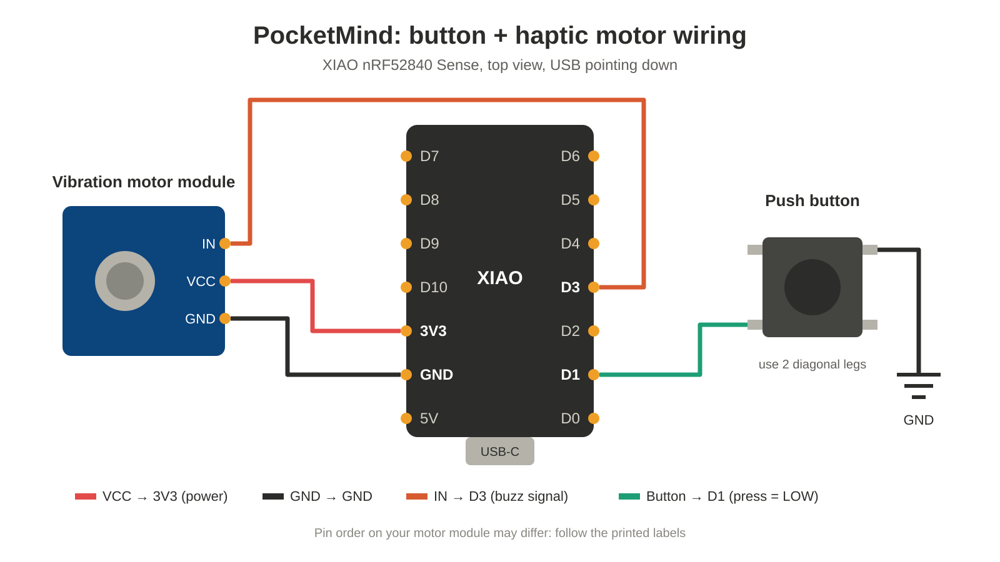

# PocketMind part 5: one-button recorder with haptics

The firmware from part 5 of the PocketMind build series on YouTube (keshuirl).
One button now controls the recorder: **click to start recording, click again to stop and save**. A vibration motor
confirms each step, so you know what happened without looking at the board. Recordings are saved to the microSD card as
`REC001.WAV`, `REC002.WAV`, … (16 kHz, 16-bit, mono WAV), flushed to the card every second so a recording is never lost
by more than 1 s. Built with Zephyr in the nRF Connect SDK.

## Hardware
Everything from [part 3](../part3-first-recording) (XIAO nRF52840 Sense + microSD breakout on a breadboard) and the
3.7 V battery from part 4, plus:
- a push button (4 legs: use 2 diagonal legs)
- a vibration motor module (pins IN, VCC, GND)

## Wiring (new parts)

| Part | Pin | XIAO |
|------|-----|------|
| Push button | one leg | D1 |
| Push button | diagonal leg | GND |
| Vibration motor module | IN | D3 |
| Vibration motor module | VCC | 3V3 |
| Vibration motor module | GND | GND |

The SD card wiring stays as in [part 3](../part3-first-recording). The pin order on your motor module may differ:
follow the labels printed on it.

## How it works
| You see / feel | Meaning |
|----------------|---------|
| 1 buzz at power-on | Ready |
| Green LED on | Idle, waiting for a click |
| Click → 1 buzz, blue LED on | Recording |
| Click again → 2 buzzes | Saved |
| Red blinks 2× | SD card problem (wiring or card) |
| Red blinks 3× | Could not create the file |
| Red blinks 4× | Microphone problem |

The battery charges at 100 mA over USB-C (the firmware sets this).

## Build and flash (VS Code + nRF Connect extension)
1. Copy `prj.conf`, `app.overlay` and `CMakeLists.txt` from [part3-first-recording](../part3-first-recording) into
   this folder (the settings are the same), next to `src/main.c`.
2. In VS Code, open the nRF Connect panel → **Open an existing application** → select this folder.
3. **Add build configuration** → board: `xiao_ble/nrf52840/sense` → **Generate and Build**.
4. Double-tap the reset button on the XIAO: it opens as a USB drive (bootloader mode).
5. Copy `build/pocketmind_rec/zephyr/zephyr.uf2` onto that drive. The board restarts, buzzes once and shows green.

To listen: unplug the board first, then take the card out and play the WAV files on your computer.

## Files
- `src/main.c`: button + haptics + recorder (mic → WAV file on the SD card)
- `docs/wiring-diagram.png`: button and vibration motor wiring

## Datasheets
The XIAO and microSD breakout datasheets are in [part3-first-recording/datasheets](../part3-first-recording/datasheets).
