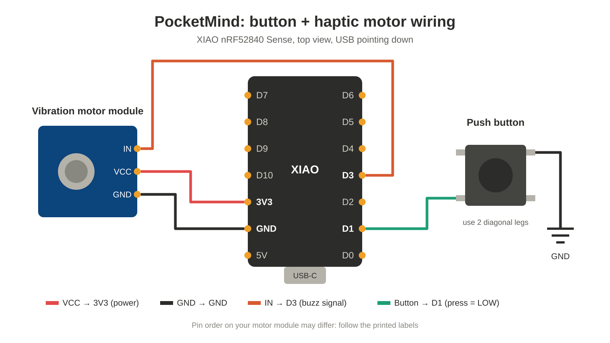

# PocketMind part 6: download recordings over Bluetooth

The firmware from part 6 of the PocketMind build series on YouTube (keshuirl).
The recorder from [part 5](../part5-button-haptics) (one button, vibration motor, WAV files on the microSD card) can now
**send its recordings to your phone over Bluetooth Low Energy**, so you no longer need to take the card out.
The board shows up as **PocketMind**, and you download files with Nordic's free **nRF Connect Device Manager** app
(Android and iOS). Built with Zephyr in the nRF Connect SDK; the transfer uses Zephyr's MCUmgr file commands.

## Hardware and wiring
Same as [part 5](../part5-button-haptics): XIAO nRF52840 Sense, microSD breakout, 3.7 V battery, push button on D1,
vibration motor module on D3. No new parts: Bluetooth is built into the XIAO.

## Build and flash (VS Code + nRF Connect extension)
This folder has everything it needs (`prj.conf`, `app.overlay`, `CMakeLists.txt`, `src/main.c`).
1. Download this folder and put it in your user folder.
2. In VS Code, open the nRF Connect panel → **Open an existing application** → select this folder.
3. **Add build configuration** → board: `xiao_ble/nrf52840/sense` → **Generate and Build**.
4. Double-tap the reset button on the XIAO: it opens as a USB drive (bootloader mode).
5. Copy `build/pocketmind_rec/zephyr/zephyr.uf2` onto that drive. The board restarts, buzzes once and shows green.

## Record
| You see / feel | Meaning |
|----------------|---------|
| 1 buzz at power-on | Ready |
| Green LED on | Idle, waiting for a click (also: safe to download) |
| Click → 1 buzz, blue LED on | Recording |
| Click again → 2 buzzes | Saved as `REC001.WAV`, `REC002.WAV`, … |
| Red blinks 2× | SD card problem (wiring or card) |
| Red blinks 3× | Could not create the file |
| Red blinks 4× | Microphone problem |
| Red blinks 5× | Bluetooth problem |

## Download a recording to your phone
1. Install **nRF Connect Device Manager** (Nordic Semiconductor) from the Play Store or App Store.
2. Make sure the board is idle (green LED), not recording.
3. Open the app and connect to **PocketMind**.
4. Go to the **Files** tab and enter the file path, for example `/SD:/REC001.WAV`, then download it.
5. When you disconnect, the board advertises again, ready for the next download.

## Faster transfers
The last 6 lines of `prj.conf` (the "SPEED-UP" block) are commented out. That is the "before" in the video.
Uncomment them and build again for the "after": they allow bigger Bluetooth packets and the faster 2M radio mode, so
files download faster.

## Files
- `src/main.c`: button + haptics + recorder (mic → WAV file on the SD card) + Bluetooth advertising
- `prj.conf`: Zephyr settings (mic, SD card, FAT + exFAT, Bluetooth, MCUmgr file access, speed-up block)
- `app.overlay`: SD card on SPI2 (D8 = CLK, D9 = SO, D10 = SI, D2 = CS) and the PDM mic
- `CMakeLists.txt`

## Datasheets
The XIAO and microSD breakout datasheets are in [part3-first-recording/datasheets](../part3-first-recording/datasheets).
